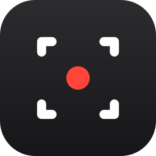

<div align="center">
  

  # FrameLine 🎯

  **Screenshots and screen recordings from your menu bar. Fast, simple, 100% local.**

  [](#-install)
  [%22&replace=%241&label=version&color=ff3b30&style=flat-square)](https://github.com/SAASEmpiree/homebrew-tap#frameline)
  [](#-build-from-source)
  [](#-what-it-does)

  <br />

  <a href="https://github.com/SAASEmpiree/frameline/releases/latest/download/FrameLine-macOS.zip"></a>

  <a href="https://github.com/SAASEmpiree/frameline/releases/latest/download/FrameLine-Windows.zip"></a>

  <sub>macOS 14+ · Apple Silicon &nbsp;|&nbsp; Windows 10 (2004+) / 11 · x64 · beta &nbsp;|&nbsp; <a href="https://github.com/SAASEmpiree/frameline/releases">all versions</a></sub>
</div>

---

## 💡 What it does

FrameLine takes screenshots and records your screen from the menu bar. Press a shortcut, drag over an area (or click a window), and the capture pops up as a small preview you can copy, annotate, pin on screen or drag straight into another app. Recordings capture the system sound and your microphone, and can be trimmed right after. Everything stays on your Mac: no account, no cloud, no upload.

## ✨ Features

- 🖼️ **Area, window or full screen** — with a loupe and pixel colour while you select, plus a 3 / 5 / 10 s timer for full screen.
- 🎬 **Screen recording** — with system audio and microphone on macOS 15+ (ScreenCaptureKit), start and stop from the menu or **⇧⌘E**.
- 🪟 **Quick preview** — floating thumbnail after each capture, in the corner you choose; drag and drop it anywhere.
- ✏️ **Annotation editor** — rectangle, arrow, pencil, text, pixelate and crop.
- ✂️ **Video trimmer** — trim a recording in place, the twin of the image editor.
- 🔤 **Copy text (OCR)** — Apple Vision reads the text in a capture and puts it on the clipboard.
- 📌 **Pin to screen** — keep a capture floating above your windows, or pin the image on your clipboard.
- 🗂️ **History & library** — recent captures in a floating panel, every capture in one window.
- ⌨️ **Global shortcuts** — **⇧⌘4** area, **⇧⌘8** window, **⇧⌘9** full screen, **⇧⌘E** record (physical keys, so they work on AZERTY too).
- 🗣️ **UI in 10 languages** — switch the display language live; light, dark or system theme.
- 🤖 **Local MCP server** — Claude Code, Cursor or Coucou can take screenshots, record the screen and read your captures (127.0.0.1 only, secret token, can be turned off in Settings).
- 🔔 **Capture sounds**, PNG or JPG output, copy-to-clipboard and open-in-editor after capture, launch at login.

## 📦 Install

**Direct download (easiest):**

1. Download [**FrameLine-macOS.zip**](https://github.com/SAASEmpiree/frameline/releases/latest/download/FrameLine-macOS.zip) (always the latest version).
2. Unzip it and drag **FrameLine.app** into your **Applications** folder.
3. Open it. FrameLine is not notarized yet, so the first time macOS blocks it: open **System Settings → Privacy & Security**, scroll down and click **Open Anyway** next to FrameLine (only once). Or, in Terminal: `xattr -dr com.apple.quarantine /Applications/FrameLine.app`.

**With Homebrew (macOS):**

```sh
brew install --cask saasempiree/tap/frameline
```

A **FrameLine icon** appears in the menu bar and the setup guide walks you through **Screen Recording** permission; **Microphone** is only asked if you record your voice. Requires **macOS 14+** on Apple Silicon.

### 🪟 Windows (beta)

The same app for Windows 10 (version 2004 or later) and Windows 11, x64. Shortcuts are **Ctrl+Shift+4** area, **Ctrl+Shift+8** window, **Ctrl+Shift+9** full screen, **Ctrl+Shift+E** record; FrameLine lives in the notification area (system tray).

1. Download [**FrameLine-Windows.zip**](https://github.com/SAASEmpiree/frameline/releases/latest/download/FrameLine-Windows.zip) (always the latest version).
2. Right-click the zip → **Extract All**, then open the **FrameLine** folder and run **FrameLine.exe**. Keep the files of that folder together.
3. FrameLine is not code-signed yet: if Windows SmartScreen says "Windows protected your PC", click **More info** → **Run anyway** (only once).
4. Screen recording needs the [Microsoft Visual C++ 2015-2022 x64 runtime](https://aka.ms/vs/17/release/vc_redist.x64.exe), already present on most PCs.

The Windows version is a beta: it is built from the same feature set, but has had less real-world testing than the Mac app. Captures go to `Pictures\FrameLine`, settings to `%APPDATA%\FrameLine`.

## 🔄 Updates

FrameLine has no built-in updater. Installed from a zip (Mac or Windows)? Download it again with the button above and replace the app. Installed with Homebrew?

```sh
brew upgrade --cask frameline
```

## 🛠️ Build from source

Swift Package Manager, no Xcode project. Needs the Swift toolchain (`xcode-select --install`).

```sh
./scripts/setup_signing.sh            # once: local "SAASEmpire Local Signing" identity, so Screen Recording permission survives rebuilds
./scripts/build_app.sh                # swift build -c release → build/FrameLine.app (hardened runtime)
./scripts/build_app.sh --install      # same, then installs into /Applications/My App/
```

Without the signing identity the build falls back to ad-hoc signing, and macOS asks for Screen Recording again after every rebuild. The version is `CFBundleShortVersionString` in `Resources/Info.plist`.

## 🗂️ Project layout

```
Package.swift             # SPM executable target "FrameLine" (macOS 14+)
Sources/FrameLine/        # the app: AppKit + SwiftUI, ~10k lines
  ScreenCapturer.swift    #   screenshots (ScreenCaptureKit)
  RecordingManager.swift  #   screen + audio recording
  PreviewWindowController #   annotation editor
  VideoTrimmer.swift      #   recording trimmer
  TextRecognizer.swift    #   OCR (Vision)
  MCP/                    #   local MCP server (127.0.0.1, Bearer token)
  Strings.swift / I18n    #   UI strings × 10 languages
Resources/                # Info.plist, AppIcon-1024.png, capture sound
scripts/                  # build_app.sh, setup_signing.sh, make_icon.swift, test-mcp.sh, mcp-smoke.sh
tests/                    # MCP unit and loopback integration tests
frameline-logo/           # logo set: png, icns, svg, menu-bar templates
BRIDGESHOT_PARITY.md      # feature parity backlog
app.json                  # manifest read by the tap's ship tool
```

## 🚢 Release

Installing FrameLine runs the tap's sync, which pushes `main`, tags `v<version>`, publishes the build on the tap and attaches the same zip as `FrameLine-macOS.zip` to this repo's latest release (the download button above). The Windows build (`FrameLine-Windows.zip`) is carried over to each new release until a newer Windows build replaces it. See [homebrew-tap/tools](https://github.com/SAASEmpiree/homebrew-tap/tree/main/tools).

## 📄 License

All rights reserved. See [LICENSE](./LICENSE). © SAAS Empire

<div align="center"><sub>Frame it, ship it, nothing leaves your Mac.</sub></div>
